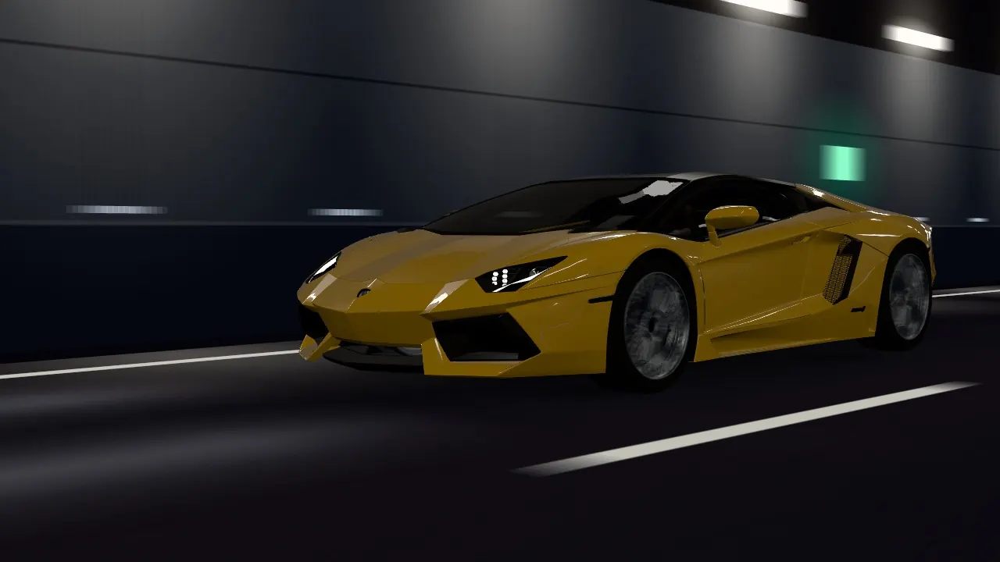
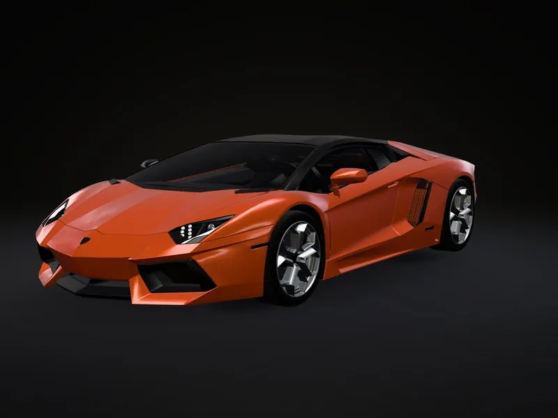
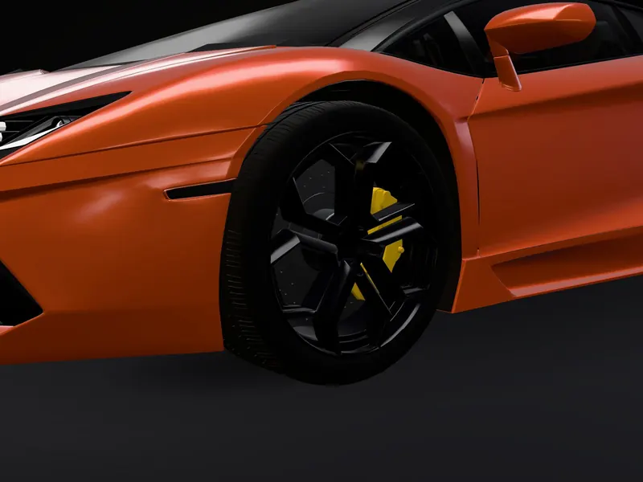
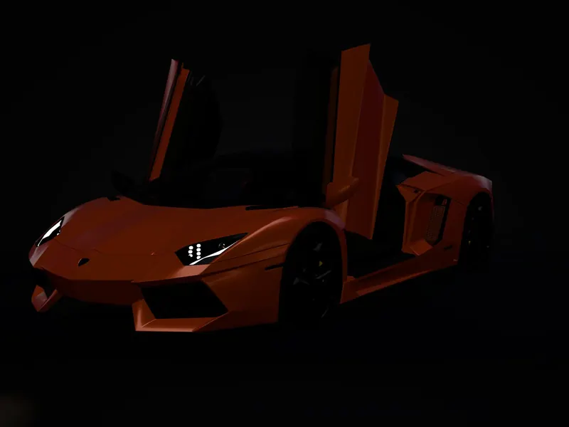
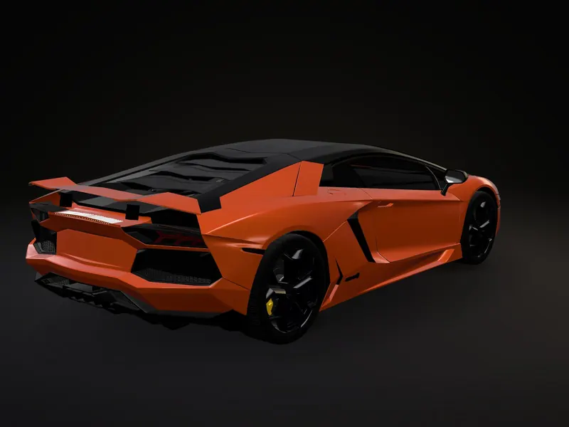
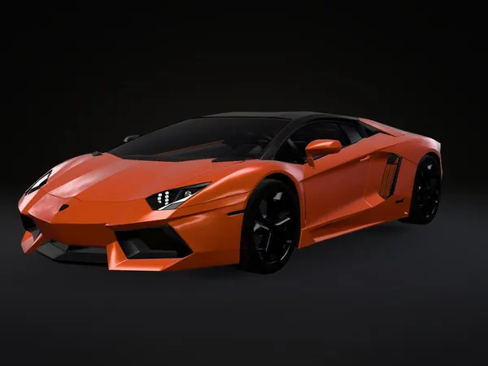
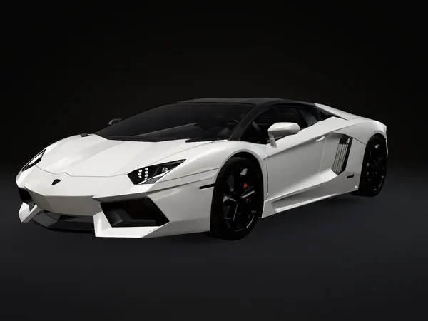
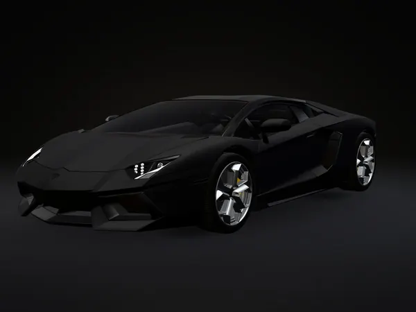

<p align="center"></p>

<p align="center"><b>Build the car one part at a time.</b></p>

<p align="center">
  <a href="https://z10ren.github.io/LamborghiniWeb/">Home page</a> ·
  <a href="https://z10ren.github.io/LamborghiniWeb/configure.html">Configurator</a> ·
  <a href="https://z10ren.github.io/LamborghiniWeb/configure-3d.html">3D configurator</a>
</p>

<p align="center"><a href="https://z10ren.github.io/LamborghiniWeb/"></a></p>

AURELION is a car configurator site built to cover different models. This version features the **Lamborghini Aventador LP 700-4**, the coupé Lamborghini built from 2011 to 2016. You choose the paint, the wheel finish, the brake calipers and the interior leather, and only the part you change updates on screen. Everything else about the car stays exactly as it was.

The site has three pages: a home page that tells the car's story and opens with a test-drive video, a picture configurator that loads fast on any device, and a 3D configurator for rotating the car. The options follow the factory list for the LP 700-4, and the site shows no prices.

## Contents

- [About AURELION](#about-aurelion)
- [The brand](#the-brand)
- [The car: Lamborghini Aventador LP 700-4](#the-car-lamborghini-aventador-lp-700-4)
- [A tour of the site](#a-tour-of-the-site)
- [Every option in the configurator](#every-option-in-the-configurator)
- [How it works](#how-it-works)
- [Speed and data use](#speed-and-data-use)
- [Accessibility](#accessibility)
- [Run it locally](#run-it-locally)
- [Publishing on GitHub Pages](#publishing-on-github-pages)
- [Project structure](#project-structure)
- [Rebuilding the assets](#rebuilding-the-assets)
- [Adding another model](#adding-another-model)
- [Credits and licences](#credits-and-licences)
- [Sources](#sources)
- [Team](#team)

## About AURELION

### The idea

Most car configurators repaint the whole picture every time you change something, so it is hard to tell what actually changed. AURELION is built around one rule: **change one thing, and only that thing changes.** Pick a new paint and the body changes colour while the wheels, calipers and cabin stay put. Pick red calipers and nothing but the calipers turns red.

That rule shapes everything else:

- The pictures are stacked layers, one for each part, so a change swaps a single layer.
- The 3D version recolours only the parts that belong to the option you picked.
- A test script checks every option against every view to prove the rule holds.

### One brand, many cars

AURELION is the name above the car, not the car itself. The site is set up so a model is described by its own data: a 3D model, a list of options with sources, and the pictures rendered from that model. The Aventador LP 700-4 is the model on the site now. Other models can be added the same way later (see [Adding another model](#adding-another-model)).

### What the site is and isn't

- It is a place to explore the car, build a version you like, and save or share it.
- It is not a shop. There are no prices, and the booking and newsletter forms are demos that send and store nothing.
- It uses factory names for every colour and option, such as Arancio Argos or Nero Ade, and it lists where each fact came from.
- On-screen colours are renderings of the factory colours, so they are close but not exact.
- AURELION is not affiliated with or endorsed by Automobili Lamborghini S.p.A.

## The brand

### Name and logo

The AURELION logo is a wide, gold metallic wordmark. It appears:

- in the navigation bar and the footer of the home page,
- in the top bar of both configurators, where it doubles as the link back home,
- in the bottom-left corner of every build image you save,
- as a gold "A" in the browser tab.

| File | Use |
|---|---|
| `assets/brand/aurelion-logo.svg` | The main logo, a sharp vector file used across the site |
| `assets/brand/aurelion-logo.png` | A 2400-pixel-wide copy for documents and slides |
| `assets/brand/favicon.svg`, `favicon-32.png` | The browser tab icon |
| `assets/brand/apple-touch-icon.png` | The icon when the site is saved to a phone's home screen |
| `assets/brand/source/aurelion-logo-original.jpg` | The original logo artwork |

### Colours

The site is dark, so the car and the gold do the talking.

| Colour | Hex | Where it's used |
|---|---|---|
| Black | `#050505` | Page background |
| Deep black | `#030303` | Home page sections and footer |
| Surface | `#0b0b0c` | Configurator panels |
| Off-white | `#f3f2ee` | Main text |
| Grey | `#8f8e89` | Secondary text and labels |
| Gold | `#e6b31e` | Buttons, highlights, active choices, the drawings |
| Ember | `#ff6b00` | The second colour in gold gradients, such as the loading bar |

### Type

| Typeface | Role | Licence |
|---|---|---|
| **Syncopate** | Headlines and big numbers, set in wide capitals | Apache License 2.0 |
| **Space Grotesk** | Labels, buttons, data readouts | SIL Open Font License 1.1 |
| **Inter** | Body text | SIL Open Font License 1.1 |

All three fonts are stored in the repository (`assets/fonts/`), so the site doesn't depend on an outside font service.

### Voice and imagery

- **Words:** short and factual. Factory names, real figures and a source for each fact. No prices.
- **Pictures:** every image of the car, from the configurator views to the video, is rendered from the same 3D model. The car looks the same everywhere, and the home page labels the video as computer-rendered.
- **Drawings:** the engineering section uses gold line drawings traced from the 3D model's side and top outlines, so their proportions match the real car.

## The car: Lamborghini Aventador LP 700-4

### Where it comes from

Ferruccio Lamborghini was born on 28 April 1916 in Cento, Italy. After the Second World War he started building tractors for local farmers out of surplus military parts, and in 1948 he unveiled his first tractor, the Carioca. Lamborghini Trattori grew from there.

The story most often told about what came next involves his own Ferrari. Its clutch kept giving trouble, and he found it used the same type of clutch as his tractors. Accounts differ on the details, but he decided to build a better grand tourer himself. **Automobili Lamborghini was founded on 7 May 1963 in Sant'Agata Bolognese**, where the company still builds its cars.

The cars that followed set the path the Aventador sits on:

| Year | Car | Why it matters |
|---|---|---|
| 1964 | 350 GT | Lamborghini's first production car, shown at the Geneva Motor Show |
| 1966 | Miura | The mid-engined V12 that started the habit of naming cars after fighting bulls |
| 1971 | Countach | Shown as a prototype at Geneva; the wedge shape and scissor doors became the brand's look |
| 1990 | Diablo | The Countach's successor |
| 2001 | Murciélago | The first all-new Lamborghini under Audi ownership |
| 2011 | Aventador | A new V12 and a carbon-fibre chassis |

### The name

Ferruccio Lamborghini was born under the sign of Taurus, which is where the raging bull in the badge comes from. After visiting the ranch of a famous breeder of fighting bulls, he began naming his cars after bulls and the world of bullfighting, starting with the Miura in 1966.

**Aventador was a fighting bull that fought in the bullring of Zaragoza, Spain, in October 1993** and was recognised for its courage. The car kept the tradition, just as the Murciélago had before it.

### What "LP 700-4" means

| Part | Meaning |
|---|---|
| **LP** | *Longitudinale Posteriore*, Italian for the V12 mounted lengthwise behind the cabin |
| **700** | 700 CV (metric horsepower) |
| **4** | Four-wheel drive |

### How it was built

Filippo Perini designed the car, known inside Lamborghini as LB834.

- **Carbon-fibre monocoque.** The Aventador was the first production Lamborghini built around a carbon-fibre monocoque. The passenger cell, roof included, is a single carbon shell that weighs 147.5 kg, with aluminium frames bolted on at the front and rear. The structure resists 35,000 Nm of twisting force per degree.
- **A new V12.** The L539 engine is a 6.5-litre (6,498 cc) V12 with no turbos and no electric help. It makes 700 CV at 8,250 rpm and 690 Nm at 5,500 rpm.
- **ISR gearbox.** The 7-speed Independent Shifting Rods gearbox is a single-clutch automated manual. Lamborghini quotes 50-millisecond shifts in its fastest mode.
- **Four-wheel drive.** A Haldex IV coupling varies how much drive goes to the front wheels.
- **Pushrod suspension.** The springs and dampers sit inboard, worked by pushrods, an idea taken from racing cars.
- **Front axle lift.** An optional system raises the nose by 40 mm for ramps and kerbs.
- **Active rear wing.** The wing lies flush with the engine cover and rises to 4° for stability at high speed or 11° for more downforce at mid-range speeds.
- **Cockpit.** A TFT screen replaces analogue dials, Drive Select offers Strada, Sport and Corsa modes, and the start button sits under a flip-up red cover.

### Factory figures

| | LP 700-4 coupé |
|---|---|
| Power | 700 CV at 8,250 rpm |
| Torque | 690 Nm at 5,500 rpm |
| 0–100 km/h | 2.9 s |
| Top speed | 350 km/h |
| Dry weight | 1,575 kg |
| Gearbox | 7-speed ISR |
| Drive | Permanent four-wheel drive, Haldex IV |
| Brakes | Carbon-ceramic, 400 mm at the front |
| Length / width / height | 4,780 / 2,030 (without mirrors) / 1,136 mm |

### Its run

The LP 700-4 made its public debut at the **2011 Geneva Motor Show**. Lamborghini first planned to build about 4,000 Aventadors, and it had built 5,000 by March 2016.

The coupé was followed by the Roadster, a 50th-anniversary edition in 2013, then the Superveloce, the S, the SVJ and finally the Ultimae. **Production ended in 2022 after 11,465 Aventadors**, more than the Miura, Countach, Diablo and Murciélago combined. The last one, an Ultimae Roadster painted a custom blue, went to a customer in Switzerland. In 2023 Lamborghini replaced it with a plug-in hybrid V12.

## A tour of the site

### Home page (`index.html`)

1. **Test-drive video.** The page opens on an 8-second loop of the LP 700-4 in Giallo Evros driving through a lit tunnel, rendered from the 3D model. A button pauses it.
2. **One car, one part at a time.** As you scroll, four steps show the same Arancio Argos car changing one thing at a time: paint, wheels and brakes, doors and lights, wing and lift. Each step links straight to that part of the configurator.

   | Paint | Wheels and brakes |
   |---|---|
   |  |  |
   | **Doors and lights** | **Wing and lift** |
   |  |  |

3. **Factory figures.** The six headline numbers, with their source.
4. **Starter builds.** Three ready-made builds to open in the configurator, or start from the standard car.

   | Arancio Argos | Bianco Isis | Nero Nemesis |
   |---|---|---|
   |  |  |  |
   | Pearl orange, glossy black wheels, black calipers | Solid white, glossy black wheels, orange calipers | Matte black, silver wheels, yellow calipers |

5. **Engineering.** Three chapters with drawings traced from the model:
   - *Chassis:* the carbon monocoque.
   - *Powertrain:* the V12, the ISR gearbox and the four-wheel drive.
   - *Aerodynamics:* buttons that raise the wing in the drawing to stowed, 4° or 11°, with a line explaining each position.
6. **Tech specs.** Performance, dimensions, drivetrain and brakes.
7. **Telemetry.** Power, rpm and torque, shown like instrument readouts.
8. **Cockpit.** The TFT display, the Drive Select modes and the start button under its red cover.
9. **Book a test drive.** Opens a booking form. If you arrive from the configurator, your build is already filled in. It's a demo, so nothing is sent.
10. **Footer.** The "Join AURELION" newsletter sign-up (also a demo), links to each section, the model credit and the trademark notice.

### Picture configurator (`configure.html`)

The main configurator. It shows the car in stacked pictures, so it loads quickly and works on any phone.

- **Steps:** Paint → Wheels (finish and calipers) → Interior → Performance → Summary. The panel on the side lists the choices, and the build name at the bottom updates as you go.
- **Views:** Front ¾, Side, Rear ¾, Wheel, Cabin and Night. Change views with the buttons, the arrows beside the car, the left and right arrow keys, or a swipe.
- **Previews:**
  - Opening the interior raises the scissor doors so you can see the leather.
  - The Night view turns on the bi-xenon headlamps and LED daytime running lights.
  - The Rear ¾ view shows the wing stowed, at 4° or at 11°.
  - With the front lift fitted, the Side view can show the nose raised.
- **Summary:** your full build with every choice, plus what comes with the model. From here you can:
  - **Request this build**, which opens the booking form on the home page with your build filled in,
  - **Copy build**, which copies a text summary,
  - **Save image**, which downloads a picture of your car with the AURELION logo,
  - **Start over**, which returns to the standard car.
- **Share links:** your build is saved in the address bar as a short code. For example, `configure.html#build-7.1.0.0.0` opens Arancio Argos with glossy black wheels. Anyone who opens the link sees the same car.
- **Sources:** the bottom of the panel lists every source for the options and figures, plus the model credit.

### 3D configurator (`configure-3d.html`)

The same steps and options, with the car in real-time 3D. Drag to rotate, and pinch or scroll to zoom. The camera moves to the right view for each step, and the doors, lights, wing and lift animate. It downloads about 10 MB, so it's a separate page you choose to open, and you can switch between the two pages without losing your build. If a browser can't run 3D graphics, the page says so, and your choices still build the summary.

## Every option in the configurator

### Paint: the 13 launch colours

| Colour | Finish | |
|---|---|---|
| Nero Aldebaran | Solid | Standard |
| Giallo Evros | Solid | Standard |
| Bianco Isis | Solid | Option |
| Nero Pegaso | Metallic | Option |
| Grigio Estoque | Metallic | Option |
| Grigio Antares | Metallic | Option |
| Blu Hera | Metallic | Option |
| Arancio Argos | Pearl | Option |
| Arancio Atlas | Pearl | Option |
| Giallo Orion | Pearl | Option |
| Nero Nemesis | Matte | Option |
| Bianco Canopus | Matte | Option |
| Marrone Apus | Matte | Option |

Each finish has its own look: the solid, metallic and pearl paints have a glossy clear coat, the pearls shift colour slightly at different angles, and the mattes are flat with almost no shine. In the picture configurator, a light sweep crosses the body when the colour changes.

### Wheels and brakes

| Wheel finish | |
|---|---|
| Silver | Standard |
| Glossy black | Option |

The 3D model has one wheel design, so only the finish changes.

| Brake calipers | |
|---|---|
| Black | Standard |
| Red | Option |
| Orange | Option |
| Grey | Option |
| Yellow | Option |

Carbon-ceramic brakes are standard on the LP 700-4.

### Interior leather

| Leather | Style |
|---|---|
| Nero Ade | Unicolor |
| Terra Dirce | Elegante |
| Sabbia Nefertem | Sand |

The leather is shown as one colour on the seats, tunnel and dashboard, because the 3D model can't separate two-tone panels.

### Performance

| Front axle lifting system | |
|---|---|
| Not fitted | Standard |
| Fitted | Option: raises the front by 40 mm |

There were no power upgrades for the LP 700-4.

### Previews and included equipment

- **Active rear wing:** stowed, 4° or 11°. It deploys on its own as speed rises, so it's a preview, not a choice.
- **Lights:** bi-xenon headlamps with LED daytime running lights.
- **Included:** the transparent engine bonnet with glass insets is part of this 3D model and can't be changed.

## How it works

### One part at a time, in pictures

Each view is a stack of transparent pictures rendered from the 3D model: a base picture of the car, then a separate layer for the paint, the wheels, the calipers and, in the cabin, the leather. Changing an option swaps only its own layer and fades it in. The views also have states, such as the wing positions in Rear ¾ or the raised nose in Side. All of this is described in `data/views.json`.

The 3D configurator works the same way with materials instead of pictures. Each option is tied to named parts of the model (`js/configurator/parts.js`), so picking a caliper colour recolours only the caliper parts.

`tools/check_isolation.py` proves the rule. It changes every option in every view and checks that only the expected pixels or parts change: 225 picture checks and 25 3D checks, all passing.

### Data, not hard-coded pages

| File | What it holds |
|---|---|
| `data/options.json` | The car's name and figures, every option group and choice, the previews, and the list of sources |
| `data/views.json` | The six views, their states and which picture layers belong to each |
| `data/outlines.json` | The side and top outlines traced from the model, used for the engineering drawings |

The configurator builds its panel from `options.json`, so adding or renaming an option is a data change.

### The test-drive video

The video is rendered from the same 3D model as everything else: the car drives through a tunnel at a steady speed, with the tunnel lights sweeping over the body and the wheels turning, in an 8-second loop that joins up seamlessly. There are three versions: AV1 for browsers that support it (about 0.5 MB), H.264 for the rest (about 1.2 MB), and a smaller H.264 version for narrow screens (about 0.4 MB).

### No server, no database

AURELION is a static site made of HTML, CSS and JavaScript files. There's no database, no SQL, no outside API and no API keys; the only things the site downloads are its own files. It uses features built into every modern browser:

- **Fetch** to read the option data and the 3D model,
- **Canvas** to stack the pictures and make the saved build image,
- **WebGL** (through three.js) for the 3D page,
- **IntersectionObserver** for scroll animations and pausing the video off screen,
- **Clipboard** for "Copy build",
- **Session storage** to carry your build to the booking form,
- **History** to keep your build code in the address bar,
- **matchMedia** to pick phone-size pictures and respect the reduced-motion setting,
- **Dialog** for the booking form.

Because it's static, GitHub Pages can host it as it is.

## Speed and data use

- Pictures are WebP. Phones get 960-pixel versions of the configurator layers; larger screens get the full 1600-pixel versions.
- The home page uses smaller image sizes on smaller screens.
- Fonts are stored with the site, and the main ones are preloaded so they arrive early.
- The video starts downloading only after the rest of the page has loaded. Each browser gets the smallest version it can play, and the video pauses when you scroll past it.
- The video doesn't play automatically if you've turned on reduced motion or Data Saver.
- Sections further down the home page aren't drawn until you scroll near them.
- The picture configurator loads other views in the background when the browser is idle, and skips this on Data Saver or slow connections.
- The 3D page, the heaviest part of the site, only loads if you choose it.

## Accessibility

- The options, view buttons and other controls work with a keyboard, and the configurators have a "Skip to options" link.
- Each change is announced to screen readers, including which part changed (for example "Paint: Giallo Evros. Only the body paint changed.").
- The video has a pause button and is hidden from screen readers, because it's decoration.
- With reduced motion turned on, the video, the custom cursor and the transitions are switched off or simplified.
- Images have text descriptions, and the car views describe the current build.
- If "Copy build" is blocked, the text appears selected so you can copy it yourself.

## Run it locally

You need a small local web server, because browsers block the configurators when the HTML files are opened straight from the folder. Python has one built in:

```
python3 -m http.server
```

Then open http://localhost:8000. If you open `configure.html` by double-clicking it, the page shows this same instruction.

## Publishing on GitHub Pages

The repository is published with GitHub Pages from the `main` branch, at https://z10ren.github.io/LamborghiniWeb/. All links in the site are relative, so it works under the `/LamborghiniWeb/` path without changes. The empty `.nojekyll` file tells GitHub to serve the files as they are.

## Project structure

```
index.html              home page
configure.html          picture configurator
configure-3d.html       3D configurator

css/
  fonts.css             the three self-hosted fonts
  site.css              home page base styles
  tailwind.css          compiled Tailwind utility classes
  landing.css           home page sections, video and animations
  configurator.css      both configurators

js/
  site.js               home page: video, scroll effects, wing drawing, menu, booking form
  configurator/
    main.js             starts a configurator and connects the panel to the car
    ui.js               builds the option panel from options.json
    state.js            the current build and its share code
    image-stage.js      the stacked-picture view
    viewer.js           the 3D view
    parts.js            which model parts each option changes, and the paint finishes
    animations.js       easing and motion helpers

data/
  options.json          options, figures and sources
  views.json            picture views and layers
  outlines.json         traced outlines for the drawings

assets/
  brand/                logo and icons
  fonts/                font files and their licences
  img/                  home page pictures
  models/               the prepared 3D model
  video/                the test-drive video and its posters
  views/                configurator picture layers (full size and phone size)

vendor/three/           three.js r186 and the add-ons the 3D page uses
tools/                  scripts that build the model, pictures, video, drawings and logo
```

## Rebuilding the assets

You only need this to change the pictures, the video or the model. The site itself runs without any of it.

```
npm install
npm run css                          # rebuild Tailwind
npm run prep-model                   # prepare the model (needs the source model in assets/models/source/)
pip install playwright pillow opencv-python numpy && python -m playwright install chromium
python tools/render_views.py         # configurator pictures
python tools/render_stills.py        # home page pictures
python tools/optimize_assets.py      # WebP and phone-size copies
python tools/render_drive.py         # test-drive video (needs ffmpeg)
python tools/render_outlines.py && python tools/build_illustrations.py   # engineering drawings
python tools/build_logo.py           # logo files
python tools/check_isolation.py      # check that each option changes only its own part
```

## Adding another model

AURELION is meant to hold more than one car. Adding a model follows the same path the Aventador took:

1. **Find a 3D model you're allowed to use**, and check its licence and credit requirements.
2. **Prepare it** with `tools/prep-model.mjs`, which gives the parts the names the configurator expects (body paint, wheel rims, brake calipers, leather) and compresses the file.
3. **Research the factory options** for that model and write its `options.json`, with a source for each option and figure.
4. **Render the views and layers** with `tools/render_views.py`, then the stills, the video and the drawings.
5. **Run `tools/check_isolation.py`** to make sure each option still changes only its own part.

Right now the pages load one model. Showing several would need a model picker on the home page, and a folder per model for its data and pictures.

## Credits and licences

- **3D model:** ["( FREE ) Lamborghini Aventador LP 700-4"](https://sketchfab.com/3d-models/free-lamborghini-aventador-lp-700-4-df69d51ba10146f79c8c765810ca2132) by SDC PERFORMANCE™️, licensed under [CC BY 4.0](https://creativecommons.org/licenses/by/4.0/). Modified: materials adjusted, rear wing separated, parts simplified and compressed. All car pictures and the video on the site are rendered from this model.
- **[three.js](https://threejs.org/)**, MIT licence (`vendor/three/LICENSE`).
- **Fonts:** Inter and Space Grotesk (SIL Open Font License 1.1) and Syncopate (Apache License 2.0). The licences are in `assets/fonts/`.
- **Tailwind CSS**, MIT licence.

AURELION is not affiliated with or endorsed by Automobili Lamborghini S.p.A. Lamborghini and Aventador are trademarks of their owner.

## Sources

Option list and factory figures (also linked inside the configurator):

- [Caricos: 2012 Lamborghini Aventador LP 700-4 press information](https://www.caricos.com/cars/l/lamborghini/2012_lamborghini_aventador_lp700-4/)
- [GTspirit: Lamborghini LP700-4 Aventador, all the colours (2012)](https://gtspirit.com/2012/04/03/lamborghini-lp700-4-aventador-all-the-colours/)
- [Lambocars: Aventador LP700-4 Roadster custom order](https://www.lambocars.com/lamborghini-aventador-lp700-4-roadster-custom-order/)
- [LamboDieCast: AUTOart 1/18 Aventador LP700-4 review (factory options)](https://www.lambodiecast.com/model606.html)
- [Supercars.net: Lamborghini Aventador LP 700-4 Roadster](https://www.supercars.net/blog/2012-lamborghini-aventador-lp-700-4-roadster/)

History and background:

- [Lamborghini: history milestones](https://www.lamborghini.com/en-en/history/milestones)
- [Lamborghini: Countach LP 500 turns 50 (the meaning of "LP")](https://www.lamborghini.com/en-en/news/lamborghini-countach-lp500-turns-50-the-story-of-a-legend)
- [Lambocars: Ferruccio Lamborghini, a biography](https://www.lambocars.com/ferruccio-lamborghini-a-biography/)
- [Lambocars: 50 years of Lamborghini names taken from bullfighting](https://lambocars.com/50-years-of-lamborghini-names-taken-from-bullfighting/)
- [CAR magazine: Lamborghini Aventador LP700-4 at the 2011 Geneva motor show](https://carmagazine.co.uk/car-news/first-official-pictures/lamborghini/lamborghini-aventador-lp700-4-2011-at-2011-geneva-motor-show)
- [Wikipedia: Lamborghini Aventador](https://en.wikipedia.org/wiki/Lamborghini_Aventador)
- [TFLcar: Lamborghini ends Aventador production after 11,465 examples](https://tflcar.com/2022/09/lamborghini-aventador-production-ends-news/)

## Team

AURELION was made by Jan, Gil and Ris.
